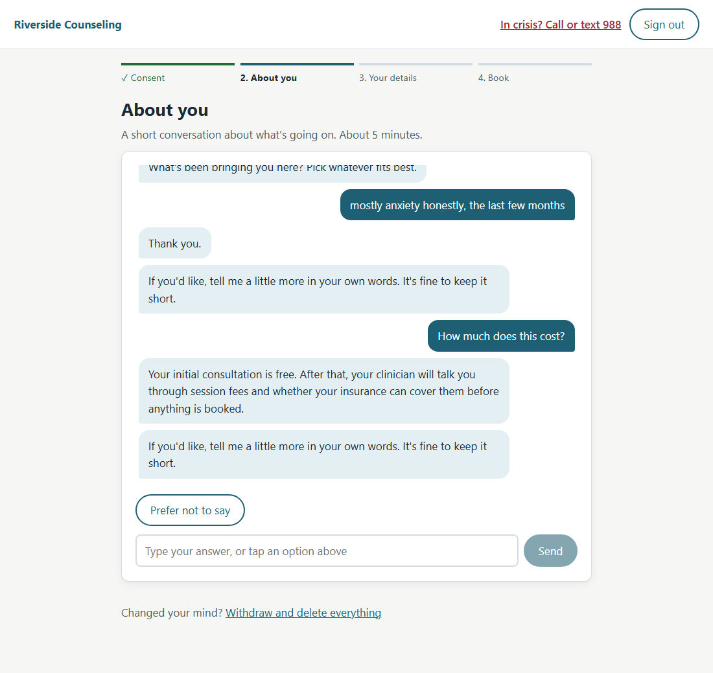

# rs-assist — AI-powered onboarding assistant

A guided, low-typing onboarding for people signing up for **outpatient mental-health
counseling**: a conversational intake, an ID photo that fills in the form, a booked first
appointment, and support at the moments people tend to give up.

Built for Riverside Partners' take-home brief ([client PRD](docs/source/client-prd.md)).
Our build spec is [docs/PRD.md](docs/PRD.md).

## Rubric map

Where each line of the client's rubric is satisfied, and the command that checks it.

| Rubric line (weight) | Where it's satisfied | Check it |
|---|---|---|
| **Core flows work, incl. edge cases & failure modes** (30) | All 4 flows with confirmation UX ([What it does](#what-it-does)); every edge case mapped to a test ([TEST_PLAN](docs/TEST_PLAN.md)); per-dependency failure matrix and fault injection ([RELIABILITY](docs/RELIABILITY.md)) | `make test` · `make smoke` · `make e2e` · `FAULT_INJECT=llm_down,ocr_fail make up` |
| **AI quality: OCR + chatbot meet thresholds, incl. hard cases** (20) | OCR 98.9% golden, **93.3% on a held-out set never tuned against**, 0 made-up fields, plus a 20-capture stress set (43.3%, mostly failing safe) with every miss categorised; intents 100% on Claude Haiku, crisis 100% incl. subtle cases ([AI evaluation](#ai-evaluation)); OCR eval is a CI gate | `make eval` |
| **Security, privacy & compliance** (20) | Consent, minimisation, retention, verifiable deletion, scoped access ([Privacy](#privacy-and-compliance)); PII boundary diagram ([ARCHITECTURE](docs/ARCHITECTURE.md#data-flow-and-the-pii-boundary)); [THREAT_MODEL](docs/THREAT_MODEL.md); log-grep test for seeded PII | `make test` (privacy tests) · `make smoke` (deletion verified) |
| **Code quality & architecture** (15) | Deep modules behind seams with fakes ([ARCHITECTURE](docs/ARCHITECTURE.md)); 94% backend coverage, 80% gate; GitLab CI ([below](#ci-hooks-and-deploy-gitlab)); [decisions](docs/DECISIONS.md) and [ADRs](docs/adr) | `make lint` · `make ci` |
| **Performance: p95 targets under stated load** (10) | Chat 2.28 s, OCR 1.18 s, booking 85 ms ([Performance](#performance)); service levels and error budgets ([RELIABILITY](docs/RELIABILITY.md#service-levels-and-error-budgets)) | `make load` · `make timings` |
| **Docs, AI disclosure & demo** (5) | This README, [AI_USAGE.md](AI_USAGE.md), eval harness, demo video *(link to follow)* | — |
| *Stretch #6, #7* | Sentiment-adaptive tone (gentle mode); Operations dashboard with funnel, per-Step time and OCR corrections. #5 multi-language not built ([why](docs/DECISIONS.md)) | `make e2e` (gentle walk) |
| *Business case* | Where and why people drop off, time to complete, NPS — measured, simulated or stated as not shown ([IMPACT](docs/IMPACT.md)) | `make cohort` |

## At a glance

| | |
|---|---|
| **Onboarding** | Consent → Intake (chat) → Identity (ID photo or typing) → Scheduling |
| **AI** | One structured LLM call per message (Claude, or OpenRouter/Ollama, or a keyless Fake); Tesseract OCR, local |
| **Results** | OCR **98.9%** field accuracy (held-out **93.3%**, **0** fabricated fields); intents **100%** on Claude Haiku 5.5, crisis language pauses **100%**; chat p95 **2.28 s on real Claude Haiku at 20 users** (Opus 5.5 would miss the 3 s target), OCR p95 **1.18 s**, booking p95 **85 ms** (local) |
| **Impact** | Funnel and "why" signals verified exact against a scripted cohort; simulated time to complete **2.8 min median** (target ≤ 15); what can't be shown without real people is stated — [docs/IMPACT.md](docs/IMPACT.md) |
| **Tests** | 239 backend tests (**94%** coverage; 3 need Tesseract/Postgres and run in CI), 64 frontend tests incl. axe + WCAG contrast, browser walks in `e2e/` |



---

## Quick start (graders)

You need **Docker** and **Node 18+** (for `npx supabase`). Everything else runs in containers.

```bash
make setup     # .env + encryption key + local Supabase (auth + Postgres); first run downloads images
make seed      # migrations + 4 clinicians, 2 weeks of slots, demo accounts
make up        # app on http://localhost:8000
```

Or all three in one: `make demo`.

Then, in another terminal:

```bash
make test      # backend (pytest, ≥80% coverage gate) + frontend (vitest + axe)
make eval      # OCR + intent scorecards → evals/reports/
make smoke     # end-to-end check of the running app (21 checks)
make e2e       # browser walks: full journey, keyboard-only (17 checks), gentle mode (7), staff screens
make load      # k6: 20 virtual users for 60 s
make timings   # 20-run OCR and booking timings
make cohort    # 30 simulated Clients at human pace -> evals/reports (see docs/IMPACT.md)
FAULT_INJECT=llm_down,ocr_fail make up   # break things on purpose (docs/RELIABILITY.md)
```

No `make` (plain Windows)? Every target is one command; read it in the [Makefile](Makefile).

### Demo accounts (created by `make seed`)

| Role | Email | Password |
|---|---|---|
| Client (fresh — walk the whole flow) | `client.demo@riverside.test` | `DemoClient!2026` |
| Client (already booked with Ana) | `client.booked@riverside.test` | `DemoClient!2026` |
| Clinician | `clinician.ana@riverside.test` (also `ben`, `sam`, `grace`) | `DemoClinician!2026` |
| Operator (dashboard) | `operator.demo@riverside.test` | `DemoOperator!2026` |

You can also create a new account from the sign-in page; email confirmation is off for
the demo (see [Production upgrades](#production-upgrades)).

### Using a real model

> **Benchmarks need Haiku.** The chat target (p95 < 3 s) is met with
> `LLM_MODEL=claude-haiku-5-5` — that is what the demo and every published number use.
> `.env.example` keeps Claude Opus 5.5 as the general default, but Opus alone takes about
> 3 s at p95, so with it the chat **misses** the 3 s target. Details: [AI evaluation](#ai-evaluation).

`.env.example` defaults to `LLM_PROVIDER=fake`, so the app and every test run without a
key. The Fake is a keyword heuristic, not a model: the chat works, but the intent scorecard
reflects the heuristic, not Claude. For the real experience, set one of:

```bash
# Claude (what the benchmarks and the deployed demo use)
LLM_PROVIDER=anthropic
ANTHROPIC_API_KEY=sk-ant-...
LLM_MODEL=claude-opus-5-5        # or claude-haiku-5-5 for the lowest latency

# Free, via OpenRouter (rate-limited; may log prompts — synthetic data only)
LLM_PROVIDER=openai_compatible
OPENROUTER_API_KEY=sk-or-...
LLM_MODEL=meta-llama/llama-3.3-70b-instruct:free

# Fully local, via Ollama
LLM_PROVIDER=openai_compatible
LLM_BASE_URL=http://host.docker.internal:11434/v1
LLM_MODEL=llama3.2
```

Then `make up` again, and `make eval` for the intent scorecard on that model.

---

## What it does

- **Consent first.** Two separate, versioned consents — onboarding data (required) and
  ID scan (optional) — plus "I'm 18 or older". Each is recorded in an identity-free
  consent log.
- **Intake is a conversation with a checklist behind it.** The server holds the list of
  required answers and decides what to ask next; the LLM interprets free text, extracts
  answers, picks a pre-approved answer to questions, and writes a one-line
  acknowledgement. Quick-reply buttons cover most answers.
- **Safety before AI.** A deterministic check runs on every message before any LLM call:
  unambiguous self-harm language pauses onboarding and shows crisis resources (988);
  ambiguous idioms ("this form is killing me") get a gentle check-in question. A
  "988" link is on every screen.
- **The AI can't invent facts or promises.** Answers to questions are pre-written
  (shown word for word); every LLM reply passes an output check that blocks times,
  prices, "confirmed", diagnoses and medication; invalid output is never shown or saved.
- **If the LLM fails, onboarding doesn't.** Timeouts or errors fall back to scripted
  questions; after two failures the rest of Intake runs scripted. Tested.
- **ID photo → review screen.** The photo is resized and stripped of metadata (incl. GPS)
  in the browser, read by Tesseract in memory, and **never stored**. Fields are pre-filled
  only when read confidently; anything uncertain is left blank, never guessed. Nothing is
  saved until the Client confirms. Typing is always an equal option.
- **Booking.** Times filtered by the Client's stated format, times of day and clinician
  preferences; double-booking is impossible (a database constraint; a test races 20 simultaneous
  bookings for one slot on real Postgres — exactly one wins — and runs in CI);
  confirmation with a calendar file.
- **Supportive content at three moments only:** a 45 s pause, an upload problem, high
  stress. Once per moment per step, never otherwise.
- **Tone adapts to stress (stretch #6).** The first sign of high stress — saying they're
  overwhelmed, rating distress 4–5, or "just stressed" at a safety check-in — switches the
  rest of Intake to a gentler mode: replies cut to one short, warm sentence, and every
  question offers a quiet "Take a break" that pauses on screen without losing anything.
  It changes how things are said, never what is asked or the safety rules.
- **Withdraw and delete everything**, with a receipt; afterwards every endpoint refuses
  that Account.
- **Clinicians** see only clients booked with them, without date of birth or address;
  every view is logged. **Operators** see an aggregate dashboard — performance, AI health,
  AI quality, the onboarding funnel (drop-off and time per step) and how often Clients
  correct each field the ID reader filled in — with no individual's data.

- **Quiet privacy reassurance.** Each Step carries one short, true line ("Your ID photo is
  never stored. Your details are encrypted."), and a footer — "Encrypted and used only to
  arrange your care" — opens a short explanation on request. No compliance claims are made
  to Clients; see [Privacy and compliance](#privacy-and-compliance).

Screenshots: [docs/screenshots](docs/screenshots).

---

## Why this stack

**Python FastAPI + React (Vite, TypeScript)**, one Docker image, Supabase (Auth +
Postgres), deployed on Railway. Python has the strongest OCR and image tooling (Tesseract,
OpenCV) for the AI core; FastAPI keeps every route and dependency explicit and easy to
review; React gives full control of accessibility, sign-in and the browser-side pause
detection. The PRD's tool names map directly: pytest ↔ RSpec, ruff ↔ RuboCop, Vitest ↔
Jest, ESLint as named. Why not Rails: [ADR 0001](docs/adr/0001-fastapi-react-not-rails.md).
Why no LangChain/LangSmith: [ADR 0002](docs/adr/0002-no-langchain-langsmith.md).

Architecture, with sequence diagrams: [docs/ARCHITECTURE.md](docs/ARCHITECTURE.md).

---

## Privacy and compliance

The assumed domain is mental-health care, so **HIPAA** is the regime that would apply.
This build is **HIPAA-ready, not HIPAA-compliant**: it holds synthetic data only.
Production would need a Business Associate Agreement with Supabase (paid plan + HIPAA
add-on) and with the LLM provider, plus the usual risk assessment and policies.

**Exactly what reaches the LLM:** only the text a Client types in the Intake chat, with
phone numbers, emails, dates and street addresses replaced by placeholders before
sending. Never their name, date of birth or address from the ID, never the ID image,
never button answers. Known limit: a name typed into free text ("I'm Jane") is not
reliably masked, and neither is the optional free-text "reason".

| Data | Where | Retention |
|---|---|---|
| ID image | Browser memory → API memory, for one request | **Never stored** |
| Name, date of birth, address | Postgres, **encrypted per field** (Fernet; key only on the app server) | Until Withdrawal |
| Intake conversation | Postgres, encrypted | **Deleted when Intake completes** |
| Assessment | Postgres; free-text reason and safety answer encrypted | Until Withdrawal |
| Consent log | Account id, action, consent version, time — no personal details | Permanent (proof) |
| Access log | Which clinician opened which booking, when | Permanent (audit) |
| Logs and timing records | Endpoint, timings, outcome — **no personal data, no account id** | — |
| Funnel analytics | Random journey id, step reached, time; per-field "pre-filled / blank / corrected" flags | Permanent, but the account→journey link is **deleted at Withdrawal** |

**Withdrawal** deletes the Assessment, conversation, identity details, booking (the slot
is released), the Account in Supabase Auth, and Supabase's own auth audit rows for that
Account (which include email and IP — see [ISSUE-001](docs/ISSUE_LOG.md)). What remains is
the consent-log entry that proves the withdrawal happened. Known limit: Supabase's
*platform* logs (outside our database) are retained by Supabase on its own schedule.

**Access control:** the browser talks to Supabase only to sign in; Supabase's Data API is
disabled for the hosted project and every table has row-level security with no
browser-facing policies (the browser's public key cannot read any table — verified). The
API is the only data path and checks ownership on every request.

---

## AI evaluation

`make eval` runs both sets through the same interfaces the app uses and writes a dated
report to [evals/reports](evals/reports).

**OCR** — 30 synthetic golden IDs (10 clean, 10 phone-photo, 10 hard: skew, glare, two-line
addresses, unusual names, a cut-off field) + 10 held-out IDs in a different layout and
font that were never used for tuning + 20 **stress** captures that look like real bad
phone photos and scans (below), also never tuned against. All synthetic, from a fictional
issuer, generated by [tools/golden_set/generate.py](tools/golden_set/generate.py).

A miss is either **left blank** (safe: the Client types it) or a **wrong value pre-filled**
(unsafe: a Client who skims the review screen could confirm it).

| Set | Field accuracy | Name | DOB | Address | Left blank | Wrong pre-filled | Made up |
|---|---|---|---|---|---|---|---|
| Golden (target ≥ 90%) | **98.9%** (89/90) | 100% | 100% | 97% | 0 | 1 | 0 |
| Held-out | **93.3%** (28/30) | 80% | 100% | 100% | 0 | 2 | 0 |
| Stress (realistic bad captures) | **43.3%** (26/60) | 45% | 50% | 35% | 31 | 3 | 0 |

Misses on the golden and held-out sets, by cause (from [evals/reports/2026-10-17-ocr.json](evals/reports/2026-10-17-ocr.json)):

| Failure category | Count | Example | Caught by | Next step |
|---|---|---|---|---|
| Accented letters dropped | 2 (held-out, name) | "José Álvarez-Ruiz" → "Jos Alvarez-Ruiz" | The review screen: pre-filled and marked "please check" | Tesseract's `eng+spa` models or a Latin-script model; score names accent-insensitively *and* report both |
| Field cut off by the card edge | 1 (golden, address) | ZIP "68326" → "6832" | The review screen — but the value was **pre-filled, not left blank**: the truncated digits were read with high confidence | Validate ZIP length (5 digits) before pre-filling, so a short ZIP is left blank instead |
| Made-up values (no basis in the image) | 0 | — | Confidence threshold + format validation | — |

**Stress set: realistic bad captures** — 2 of each (one per card layout):

| Capture | Accuracy | What happened |
|---|---|---|
| Card far away (small in frame, then resized) | 100% | Read correctly |
| Thumb over the address | 100% | Name and DOB read; the covered address correctly **left blank** |
| Bent card | 100% | — |
| Laminate glare streak | 67% | One address blanked; **one house number misread** ("949" → "349") |
| Low light (underexposed, sensor noise) | 33% | Mostly blank; **one name filled with a label** ("DATE OF BIRTH o") |
| Phone's shadow over the card | 33% | Mostly blank; **one ZIP truncated** ("35053" → "350") |
| Motion blur (hand shake) | 0% | All blank → "type it instead" |
| Security print under the text | 0% | All blank — the reader finds no confident field through the printed lines |
| Photocopy / low-resolution scan | 0% | All blank |
| Worst case (dim + shaky + shadow + heavy JPEG) | 0% | All blank |

What this shows: on bad captures the reader mostly **fails safe** — 31 of 34 misses were
left blank, so the Client is sent to typing rather than shown a guess. The 3 unsafe misses
point at three fixes, in order: (1) never accept a field label as a value; (2) check ZIP
length (5 digits) before pre-filling — also the golden-set miss; (3) treat isolated low-
confidence digits in a house number as unreadable. Accuracy on blur, security print and
photocopies would need better preprocessing (deblurring, removing coloured print by
channel) or a stronger engine (PaddleOCR) — and a *new* stress set to score it on, since
this one would then have been tuned against.

**Intents** — 65 labelled messages across all 8 intents, plus unambiguous crisis
language, subtle risk, and ambiguous idioms ([evals/datasets/intents.yaml](evals/datasets/intents.yaml)).

| Model | Overall (3 runs) | Every intent | Crisis incl. subtle cases | LLM p50 | LLM p95 |
|---|---|---|---|---|---|
| **Claude Haiku 5.5** | **100%, 100%, 100%** | ✓ | 100% | ~1.0 s | 1.76–2.02 s |
| Claude Opus 5.5 | 98%, 98%, 100% | ✓ | 100% | ~2.2 s | 2.94–3.21 s |
| Fake (keyless heuristic) | 61.5% | ✗ | unambiguous only | — | — |

Both models also caught the two *subtle* crisis messages ("giving my things away and
writing goodbye letters") that no phrase list could. Unambiguous crisis language pauses
100% regardless of model: the safety screen runs before any LLM call. Opus's only miss
(in two of three runs) was "Do you have parking?" treated as out of scope instead of
"I don't have that answer" — both redirect gracefully.

**Model choice.** The task is narrow (classify, extract, pick an approved answer, one
sentence), so the larger model buys nothing: Haiku scored as well or better at less than
half the latency and a fraction of the cost. Opus on its own sits at the edge of the 3 s
chat budget. `.env.example` documents Opus as the general default; the demo and the
benchmarks run Haiku via `LLM_MODEL=claude-haiku-5-5`. Reports for both:
[evals/reports](evals/reports).

Engine and model versions: Tesseract 5.5.0 (Debian, in the Docker image), OpenCV 5.0,
Claude via `LLM_MODEL` (default `claude-opus-5-5`, effort `low`). Hardware for the
numbers above: Windows 11 laptop, Docker (Rancher Desktop), 2 uvicorn workers.

---

## Performance

| Target | Result (local) | How |
|---|---|---|
| Chat / API p95 < 3.0 s at 20 VUs × 60 s | **2.28 s** chat, 1.91 s all API, 0% errors, 0 LLM errors in 290 messages | `make load` (k6) against **real Claude Haiku 5.5** — requires `LLM_MODEL=claude-haiku-5-5`; Opus 5.5's own p95 (~3 s) misses this target |
| (same, model latency removed) | 1.15 s chat with a fixed 800 ms fake model | `make load` with `LLM_PROVIDER=fake FAKE_LLM_DELAY_MS=800` |
| OCR p95 < 8.0 s (20 runs) | **1.18 s** | `make timings`, server `Server-Timing` header |
| Booking p95 < 1.0 s (20 runs) | **85 ms** | same |
| Uptime ≥ 99% | pinger on `/health` once deployed | [docs/DEPLOY.md](docs/DEPLOY.md) |

Details and the real-model plan: [docs/PERFORMANCE.md](docs/PERFORMANCE.md).

---

## Repository map

```
backend/            FastAPI app, domain modules, OCR, LLM adapters, migrations, tests
frontend/           React app (Vite, TypeScript), tests
evals/              eval harness, datasets (synthetic IDs, intents), reports
tools/golden_set/   synthetic ID generator
k6/                 load test and 20-run timings
scripts/            setup, end-to-end smoke test
supabase/           local Supabase config (auth + Postgres only)
docs/               PRD, architecture, decisions, test plan, runbook, deploy, logs
```

Docs index: [Impact](docs/IMPACT.md) · [PRD](docs/PRD.md) · [Users](docs/USERS.md) · [Architecture](docs/ARCHITECTURE.md) ·
[Decisions](docs/DECISIONS.md) · [Reliability](docs/RELIABILITY.md) · [Threat model](docs/THREAT_MODEL.md) · [Test plan](docs/TEST_PLAN.md) ·
[Performance](docs/PERFORMANCE.md) · [Accessibility](docs/ACCESSIBILITY.md) ·
[Deploy](docs/DEPLOY.md) · [Runbook](docs/RUNBOOK.md) · [Issue log](docs/ISSUE_LOG.md) ·
[AI log](docs/AI_LOG.md) · [Glossary](docs/GLOSSARY.md) · [AI usage](AI_USAGE.md)

---

## CI, hooks and deploy (GitLab)

- **CI:** [.gitlab-ci.yml](.gitlab-ci.yml) runs lint → tests with an 80% coverage gate →
  image build → deploy on every push. Gauntlet's GitLab has no shared runners, so it runs
  on a self-registered project runner (GitLab Runner in Docker, tag `rs-assist-local`);
  `CI_ENABLED=true` switches it on. Deploy runs once a `RAILWAY_TOKEN` variable exists.
- **AI quality gate:** `eval:ocr` fails the pipeline if golden-set accuracy drops below 90%
  or any golden or held-out field is made up. The stress set is reported, not gated. `eval:intent` (every intent handled, crisis 100%) runs on `main`
  once a masked `ANTHROPIC_API_KEY` variable exists — the keyless Fake can't pass it.
- **Pre-push hook:** [.githooks/pre-push](.githooks/pre-push) runs `make ci`; switch it on
  with `make hooks`.
- **Deploy limitation:** Railway's push-to-deploy integration supports GitHub only. With
  GitLab, deployment is via the Railway CLI (`make deploy`) or the CI deploy job.
  Steps: [docs/DEPLOY.md](docs/DEPLOY.md).
- **Supabase Free plan** pauses projects after 7 days without activity; `/health` writes a
  heartbeat row and an uptime pinger calls it, which keeps the project awake and produces
  the uptime evidence.

---

## Production upgrades

Deliberately out of scope for the timebox; each has a clear path:

- Magic-link / passwordless sign-in and email confirmation, via a proper email provider
  (the Supabase Free plan's built-in email is heavily rate-limited)
- Email booking confirmations and reminders
- In-page camera with a card outline and auto-capture; desktop-to-phone QR handoff
- RAG over policy documents once approved answers outgrow ~20 entries
- PHQ-9 / GAD-7 screeners a real clinic would add (clinical review required)
- Admin console: clinician and slot management
- Multi-language: per-language service profile, crisis phrase lists and eval examples
- LangSmith tracing, off by default and masked, for development on synthetic data

**Re-targeting to another service:** everything service-specific — steps, questions,
approved answers, supportive copy, crisis resources — lives in one file,
[backend/app/profile/counseling.yaml](backend/app/profile/counseling.yaml). Swap it for
another service's real intake procedure.
