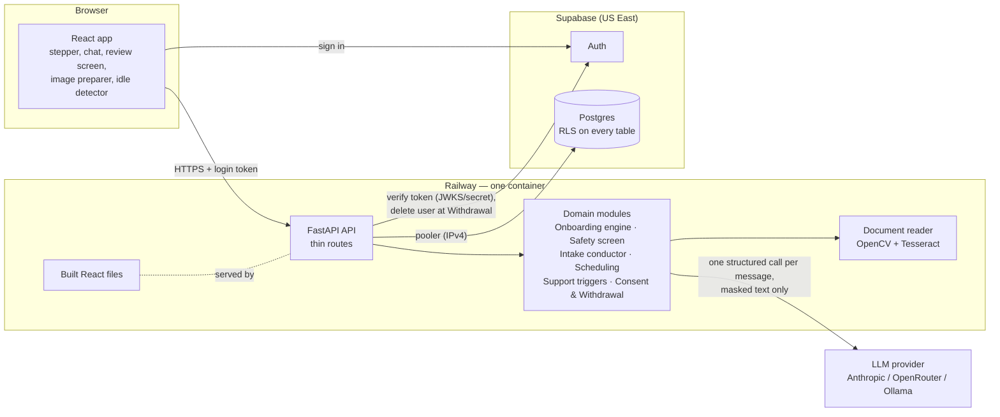
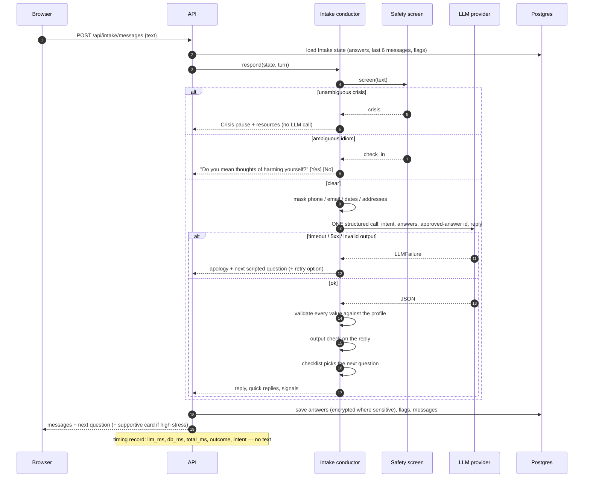
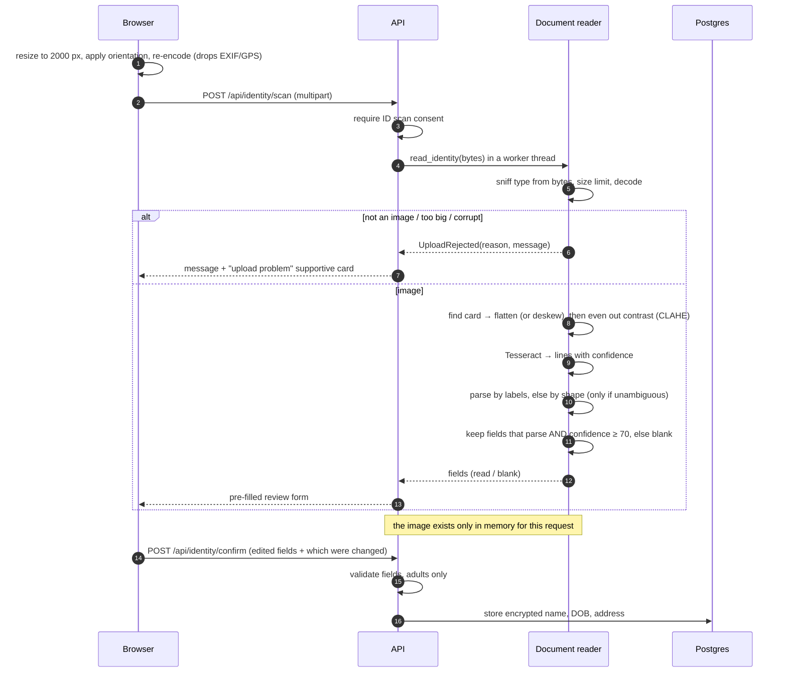
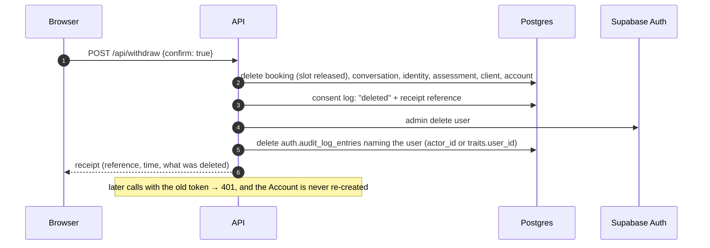
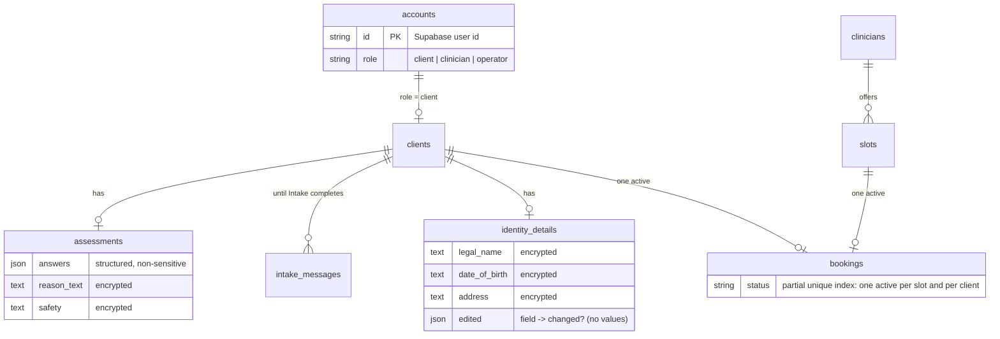

# Architecture

Written for reviewers and future maintainers. Terms in capitals (Client, Step,
Assessment…) are defined in the [glossary](GLOSSARY.md).

## High-level architecture

- **One container** serves the API and the built frontend, with Tesseract installed. One
  URL, no cross-origin setup, one deploy.
- **Supabase** provides sign-in and Postgres. The browser uses Supabase only to sign in;
  all data goes through the API. Row-level security is on for every table with no
  browser-facing policies, so the browser's public key reads nothing.
- **The LLM** sees only masked chat text. Identity details and images never leave the
  container.

## Low-level design: modules

Deep modules — a small interface over a lot of behaviour — each tested through its
interface. Swappable dependencies sit behind seams with a Fake adapter for tests.

| Module | Interface | Hides | Seams |
|---|---|---|---|
| Onboarding engine (`domain/onboarding.py`) | `state(facts)`, `check(facts, action)` | Step order, gating, Crisis pause, completion | none (pure) |
| Safety screen (`domain/safety.py`) | `screen(message) → clear / check_in / crisis` | two-tier phrase lists, normalisation | none (pure) |
| Intake conductor (`domain/intake.py`) | `respond(state, turn) → (state, reply)`, `prompt_for(state)` | checklist, masking, the one LLM call, validation, output check, scripted fallback | LLM port |
| LLM port (`llm/`) | `complete(system, messages, schema, timeout) → dict` or `LLMFailure` | provider wire formats, error mapping | Anthropic · OpenAI-compatible · Fake |
| Document reader (`ocr/`) | `read_identity(bytes) → fields + failure reason` | content sniffing, EXIF, card detection, deskew, Tesseract, parsing, confidence | OCR engine: Tesseract · Fake |
| Scheduling (`scheduling.py`) | `open_slots`, `book`, `current_booking`, `calendar_file` | window, filters, one active booking, reschedule transaction, unique index | database |
| Support triggers (`domain/support.py`) | `decide(event, shown, paused) → trigger / None` | three triggers, once per Step | none (pure) |
| Consent & Withdrawal (`consent.py`) | `grant`, `set_id_scan`, `withdraw → receipt` | consent log, cascade delete, auth deletion, audit-row cleanup | auth admin: Supabase · Fake |
| Access control (`access.py`) | `identify(request) → Caller`, `clinician_view` | token verification (HS256 or JWKS), roles, Access log | token verifier |
| Telemetry (`telemetry.py`) | `timed(stage)`, `note(...)`, `log(...)` | PII-free JSON logs, timing records, `Server-Timing` | — |
| Journeys (`journeys.py`) | `start`, `record`, `record_ocr_review`, `unlink` | anonymous funnel events, once per Journey, unlink at Withdrawal | database |
| Dashboard queries (`dashboard.py`) | `dashboard(db, hours)`, `funnel`, `ocr_corrections` | percentiles, funnel drop-off and medians, suppression of small counts (and nothing derived from them) | database |
| Service profile (`profile/`) | `get_profile()` | everything service-specific, validated at startup | file |

Shallow on purpose: HTTP routes (`api/routes.py`), the encrypted column type
(`db/crypto.py`), migrations and seed.

## Sequence: one Intake message

## Sequence: ID photo to confirmed details

## Sequence: Withdrawal

## Data model

Also: `consent_log` and `access_log` (permanent, identity-light), `timing_records` and
`daily_counters` (aggregate, no account ids), `journey_links` (account → random journey,
deleted at Withdrawal) and `journey_events` (journey, step event, time, per-field OCR
flags — nothing else), `heartbeat`, `eval_reports`.

## Deployment view

See [DEPLOY.md](DEPLOY.md). Locally, `docker compose` runs the same image against
Supabase started by the Supabase CLI.
